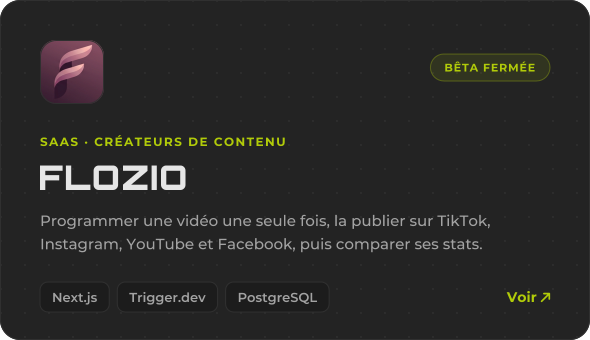
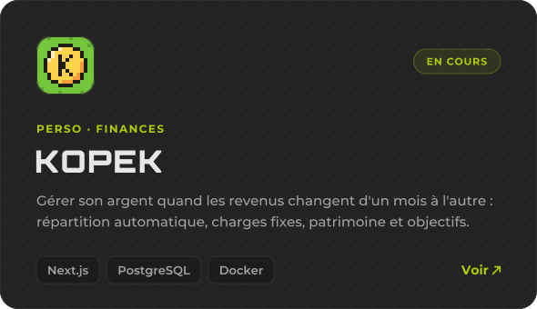
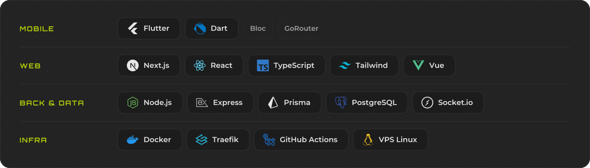

  

<picture>
  <source media="(prefers-color-scheme: dark)" srcset="./assets/title-projets.svg" />
  
</picture>

  

  
  

<picture>
  <source media="(prefers-color-scheme: dark)" srcset="./assets/title-parcours.svg" />
  
</picture>

  

<picture>
  <source media="(prefers-color-scheme: dark)" srcset="./assets/title-stack.svg" />
  
</picture>

  

<picture>
  <source media="(prefers-color-scheme: dark)" srcset="./assets/title-contact.svg" />
  
</picture>

  
  
  

